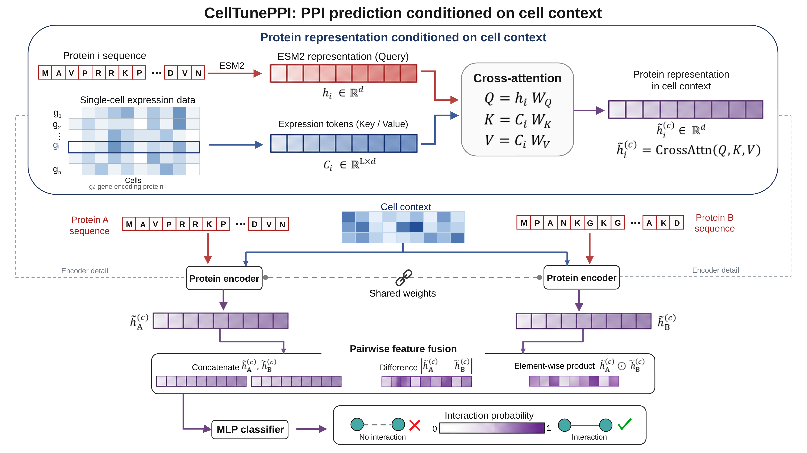

# CellTunePPI

## Overview of CellTunePPI

CellTunePPI predicts protein–protein interactions (PPIs) in a given **cell context** by adapting protein sequence representations with single-cell expression information. A protein retains its sequence-derived properties across contexts, while its expression profile can change. CellTunePPI combines these two sources of information to generate cell-contextual protein representations and predict how interaction networks vary across cell contexts.

The model uses **cross-attention** to connect sequence and expression information. For each protein, a precomputed ESM2 embedding is projected into a protein token that serves as the **query**. Expression measurements of its encoding gene across cells in the selected context are mapped into expression tokens that serve as **keys and values**. For a candidate protein pair, two encoders with shared parameters generate the corresponding contextual representations. These representations are combined through concatenation, absolute difference, and element-wise product, and an **MLP classifier** outputs the interaction probability.



## Repository contents

| Path | Description |
| --- | --- |
| `data_prep/preprocess_data.py` | Single-cell expression preprocessing and H5AD export. |
| `scripts/CellTunePPI_model.py` | Model architecture and checkpoint loading/saving. |
| `scripts/CellTunePPI_utils.py` | Shared data loading, feature matching, and evaluation utilities. |
| `scripts/CellTunePPI_predict.py` | Cell-contextual PPI prediction with a trained model. |
| `scripts/CellTunePPI_train_cv_test.py` | Model training, cross-validation, and evaluation. |
| `example_data/` | ESM2 embeddings, HEK293T/HCT116 expression data, and protein-pair tables for prediction and training/testing. |
| `model/` | Pretrained CellTunePPI model. |
| `result/` | HCT116 prediction resources. The `*_max_score.tsv` file contains 169,968 unique PPIs, merging A–B/B–A records by their maximum score. |
| `environment.yml` / `environment_cpu.yml` | CUDA 12.4 / CPU environment specifications. |

Keep the shared model and utility modules together with the entry-point scripts in `scripts/`. Further module details are provided in [scripts/MODULES.md](scripts/MODULES.md).

## Getting Started

### Dependencies

The supplied environment uses Python 3.10 and PyTorch 2.6. Core dependencies include NumPy, pandas, SciPy, AnnData, h5py, Scanpy, and Matplotlib.

Core package versions are provided in `environment.yml`. Create and activate the environment from the repository root:

```bash
conda env create -f environment.yml
conda activate celltuneppi
```

For CPU installation, use `environment_cpu.yml` instead. Further installation details are available in [INSTALL.md](INSTALL.md).

Run the following commands from the repository root. All model commands default to CUDA; add `--device cpu` for CPU execution.

### Usage

#### 1. Single-cell expression preprocessing

Prepare a tab-separated raw count matrix with **genes in rows and cells in columns**, gene identifiers in the first column, and cell identifiers in the header:

```bash
python data_prep/preprocess_data.py \
  --input path/to/raw_counts.tsv \
  --output-dir data_processed
```

The default workflow retains cells with at least 1,000 counts and 200 detected genes, retains genes expressed in at least three cells, normalizes each cell to 10,000 total counts, and applies `log1p`. The output is a float32 `.h5ad` file with **cells in rows and genes in columns**.

The processed HEK293T and HCT116 files in `example_data/` can be used directly.

#### 2. Cell-contextual PPI prediction

Prediction requires three inputs:

| Input | Format |
| --- | --- |
| Protein embeddings | `.pt` dictionary mapping protein identifiers to sequence-level ESM2 vectors; the supplied vectors have 1,280 dimensions. |
| Expression data | `.h5ad` with cells × genes and processed expression in `.X`. |
| Candidate protein pairs | `.tsv` with protein identifiers in the first two columns; optional headers are `protein_a` and `protein_b`. |

Protein identifiers must match across the pair table, ESM2 dictionary keys, and corresponding expression feature names. Expression is read without further normalization. To select an alternative H5AD layer, add `--expr-layer LAYER_NAME`.

Predict the supplied unlabelled candidate pairs in the HCT116 cell context:

```bash
python scripts/CellTunePPI_predict.py \
  --ppi-tsv example_data/example_protein_pairs_list_for_predict.tsv \
  --expr-file example_data/HCT116.h5ad \
  --esm2-file example_data/esm2_embedding.pt \
  --output-tsv result/HCT116_predictions.tsv
```

The supplied prediction list contains 763,454 unlabelled protein pairs in two columns without a header. Self-interactions and reverse-direction duplicates have been removed, retaining the first occurrence of each unordered protein pair. With the supplied HCT116 expression and ESM2 data, 563,451 pairs have complete features. Use `--ppi-tsv` to supply your own candidate pairs.

The output contains the two protein identifiers and their interaction score (`score`). Pairs with missing expression or ESM2 features are excluded and recorded in a separate `*.dropped_pairs.tsv` file.

#### 3. Model training and cross-validation

Training uses a three-column TSV containing `protein_a`, `protein_b`, and a binary `label` (`1` for positive and `0` for negative). Headers are optional.

**Train and save a model:**

```bash
python scripts/CellTunePPI_train_cv_test.py \
  --mode train_full \
  --expr-file example_data/HEK293T.h5ad \
  --esm2-file example_data/esm2_embedding.pt \
  --labels-tsv example_data/HEK293T_ppi_train.tsv \
  --ckpt-path result/train/CellTunePPI_HEK293T.pt \
  --curve-output-dir result/train
```

Training reserves 10% of the labelled pairs for internal validation and saves the model with the best validation AUROC.

**Run five-fold cross-validation:**

```bash
python scripts/CellTunePPI_train_cv_test.py \
  --mode cv \
  --expr-file example_data/HEK293T.h5ad \
  --esm2-file example_data/esm2_embedding.pt \
  --labels-tsv example_data/HEK293T_ppi_train.tsv \
  --curve-output-dir result/cv
```

#### 4. Independent testing

Test the model saved in the training step using the labelled HCT116 table:

```bash
python scripts/CellTunePPI_train_cv_test.py \
  --mode test \
  --expr-file example_data/HCT116.h5ad \
  --esm2-file example_data/esm2_embedding.pt \
  --test-labels-tsv example_data/HCT116_ppi_train.tsv \
  --ckpt-path result/train/CellTunePPI_HEK293T.pt \
  --curve-output-dir result/test
```

The script reports accuracy, AUROC, and AUPRC, and saves ROC/PR curves in `result/test/`. Replace the example input paths with your own expression, embedding, and labelled protein-pair files to train and test CellTunePPI on your data.
