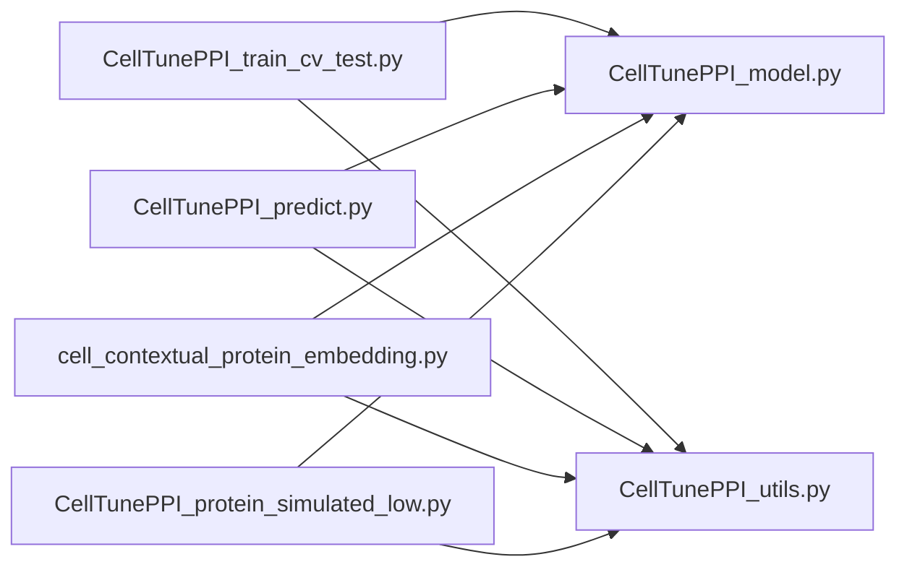

# CellTunePPI script modules

The four command-line entry points share two public implementation modules:

| Module | Responsibility |
| --- | --- |
| `CellTunePPI_model.py` | Rich-fusion model classes, model construction, checkpoint saving/loading, and the packaged checkpoint path |
| `CellTunePPI_utils.py` | Feature loading, pair matching, datasets, padding, data splitting, evaluation metrics, and curve plotting |
| `CellTunePPI_train_cv_test.py` | Training loops, cross-validation, independent evaluation, and their command-line options |
| `CellTunePPI_predict.py` | Pair prediction using the shared model and data utilities |
| `cell_contextual_protein_embedding.py` | Expression-aware protein embeddings and pair distances |
| `CellTunePPI_protein_simulated_low.py` | Expression-replacement sensitivity analysis and figures |

Each entry point imports `CellTunePPI_model` and `CellTunePPI_utils`. Neither
public module imports a command-line entry point, and the analysis entry points
do not import the training entry point by default. Keep the two public modules
beside the entry-point scripts when copying or publishing them.



Arrows denote direct project-module imports. The model and utility modules do
not import each other. `data_prep/preprocess_data.py` imports no project scripts;
its output H5AD files are consumed by the shared feature loader.

Keep the six Python files together in `scripts`, with data, checkpoints, and
results in their respective directories:

```text
github/
|-- scripts/
|   |-- CellTunePPI_model.py
|   |-- CellTunePPI_utils.py
|   |-- CellTunePPI_train_cv_test.py
|   |-- CellTunePPI_predict.py
|   |-- cell_contextual_protein_embedding.py
|   |-- CellTunePPI_protein_simulated_low.py
|   `-- MODULES.md
|-- data_prep/
|   `-- preprocess_data.py
|-- example_data/
|-- model/
|-- result/
|-- environment.yml
|-- environment_cpu.yml
`-- INSTALL.md
```

The entry points can be run in any order with their required input files.
The shared model module requires PyTorch. The utilities require PyTorch,
NumPy, Pandas, and Matplotlib, with AnnData and SciPy used for H5AD input
(HDF5 access is provided by h5py through AnnData). Preprocessing additionally
uses Scanpy. The environment definitions pin the core application dependencies.
The CUDA and CPU installation options both use the environment name
`celltuneppi`; see [INSTALL.md](../INSTALL.md).

The model and utility modules are imported libraries; they are not additional
training commands. Importing them does not start training, load data, or change
random seeds.

The existing model architecture, parameter names, feature values, metrics,
training loops, and default training hyperparameters are preserved. The
training entry point re-exports its former public helpers for compatibility
with callers that already imported them from that file.

The prediction script retains `--model-script` as an optional override for a
module providing `load_model_from_ckpt(path, device)`. Its default uses the
public model module directly. Feature loading always uses the shared utilities.
Other existing input and output arguments retain their previous behavior.

The prediction output contains exactly `gene_i`, `gene_j`, and `score`.
The score is the model's positive-class softmax probability. Pairs with
missing expression or ESM2 features are excluded and recorded in a separate
`<output-stem>.dropped_pairs.tsv` file (or the path set by `--missing-report`).

The three analysis entry points default to `model/model_trained_by_HEK293.pt`,
located relative to the scripts' installation directory. For the training
entry point's test mode, specify this checkpoint with `--ckpt-path`. New
training runs should use their own checkpoint output path.

Example prediction from the repository directory:

```shell
python scripts/CellTunePPI_predict.py --ppi-tsv example_data/HCT116_ppi_train.tsv --expr-file example_data/HCT116.h5ad --esm2-file example_data/esm2_embedding.pt --output-tsv result/hct116_predictions.tsv
```

All entry points default to CUDA. Add `--device cpu` for CPU execution.
